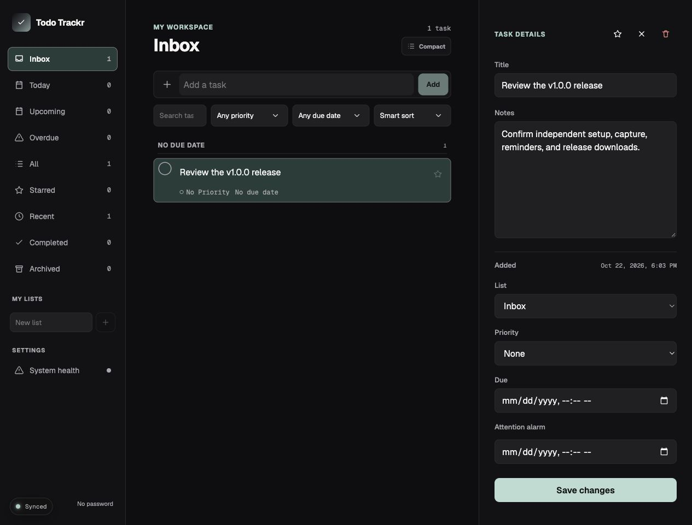

# Todo Trackr

A personal task manager with a web workspace, a native macOS companion, and a Chromium Quick Capture extension. Capture an action, organize it into a list, and set an attention alarm that stays visible until acknowledged.

Todo Trackr is open-source under the [MIT license](LICENSE). Run one workspace on your own server with PostgreSQL. No Shortcut, Granola, Codex, App Switchr, or maintainer-hosted account is required.

## Public release

The public release target is **v1.0.0**, distributed through [GitHub Releases](https://github.com/kylbutlr/todo-trackr/releases). This branch contains the release candidate. The server/container rehearsal and automated checks pass. Publication and an installed-extension acceptance check remain pending; see the [release plan](docs/self-hosted-release-plan.md).

Start with the [self-hosting guide](docs/self-hosting.md). Password protection is enabled by default. Local or privately secured installations can explicitly select passwordless access. Missing credentials never enable passwordless access.

## Features

- Capture tasks from a browser selection or page title, retaining the source URL.
- Organize tasks with Inbox, lists, stars, priorities, due dates, and smart views.
- Set persistent attention alarms independently of due dates.
- Edit the same workspace from the web and macOS clients.
- Export task data and recover deleted tasks.
- Connect each companion client to your own server.

| Component | Runtime | Distribution |
| --- | --- | --- |
| Server and web workspace | Node.js 24 and PostgreSQL, or Docker Compose | Versioned server archive and source |
| macOS companion | macOS 14 or later, Swift 6.2+ build toolchain | Source code, built locally; no Apple membership required |
| Quick Capture extension | Chromium with Manifest V3 support | Zip, loaded unpacked and updated manually |

The web app can also be added to a mobile home screen. Remote connections require an HTTPS endpoint that you configure. An address such as localhost always refers to the device opening it.



## Installation and clients

Follow [self-hosting](docs/self-hosting.md) for configuration, startup, backup, upgrade, and password modes. The standalone server serves both the web app and API and runs database-backed alarm scheduling. It does not require Netlify, Neon, or Trigger.dev.

In the Mac app or extension, enter your server origin and connect. See the [extension instructions](apps/browser-extension/README.md) for browser permissions, capture shortcuts, and manual updates. Native source-build and guarded local installation instructions are in [macOS installation](docs/macos-installation.md). The v1.0.0 release does not distribute a prebuilt Mac app or signed update feed. Source-built apps use manual updates.

The original hosted adapter remains available for the existing deployment. Its Shortcut, Granola, and Codex integrations retain personal mappings and are disabled in standalone installations. They are not advertised as general-purpose v1 features. [App Switchr](docs/app-switchr.md) is an optional hosted adapter; standalone clients do not poll it or wait for its permission.

## Development

Use Node.js 24. Install dependencies with `npm ci`, then follow the [contribution guide](CONTRIBUTING.md) for validation and the [self-hosting guide](docs/self-hosting.md) for a disposable development installation. Never use personal or production task data for tests.

```text
apps/browser-extension/  Chromium Quick Capture client
apps/macos/              SwiftUI companion
apps/web/                React workspace
server/                  Standalone HTTP server and alarm worker
netlify/functions/       Shared API and hosted adapters
database/migrations/     Ordered PostgreSQL migrations
design/                  Pinned App Stylr assets and licenses
scripts/                 Build, packaging, migration, and release tools
```

See [architecture](docs/architecture.md) for application boundaries and [product terminology](CONTEXT.md) for the domain model. The interface follows [App Stylr v1.2.0](https://github.com/kylbutlr/app-stylr/tree/b3ca31ea264d5dd233fd871ac167247f1c306985), pinned in [app-stylr.json](app-stylr.json). Intentional differences are recorded in [design exceptions](docs/app-stylr-exceptions.md).

## Privacy, security, and maintenance

The [privacy guide](docs/privacy.md) explains stored data, network access, optional services, and capture permissions. See [security](SECURITY.md) to report a vulnerability and [contributing](CONTRIBUTING.md) to propose a change. Release changes are tracked in the [changelog](CHANGELOG.md).

Keep database credentials, password verifiers, session secrets, signing keys, and task backups private. Preserve the [Geist font notice](design/GEIST-LICENSE.txt) when redistributing the application.
