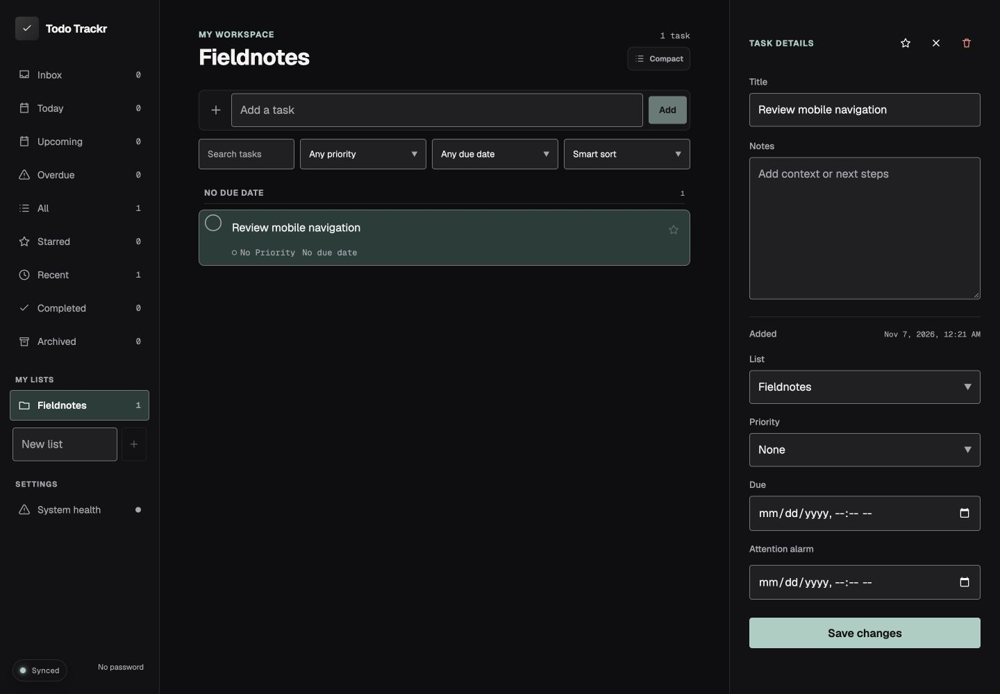
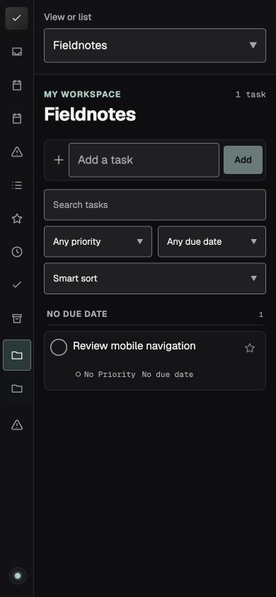
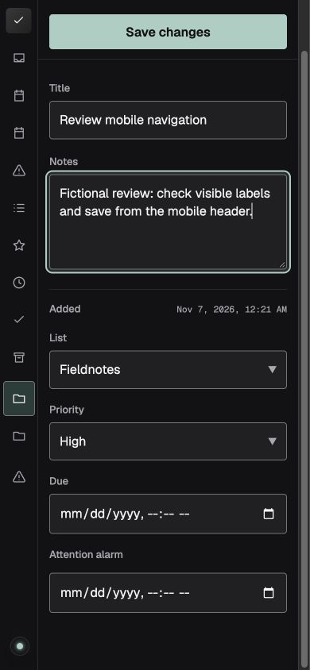
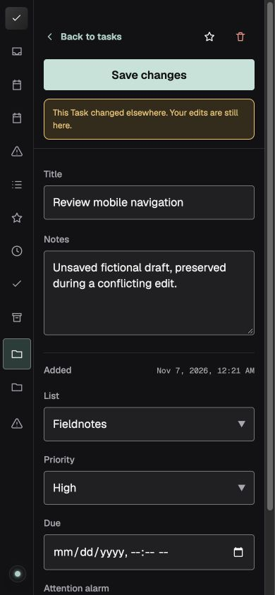

# Public-readiness refinements, November 7, 2026

Local changes on `kylebutler/public-readiness`, based on main `12f4d055b5ea1097d271501f411e155a34e20cd0`. No public release, deployment, repository visibility, or native installation was changed. Public downloads remain at their previously published contents.

## Changes

- Add a labeled phone picker for the existing task views, named lists, enabled sources, and settings. Keep the sidebar shortcuts and desktop navigation.
- Move the phone editor's explicit Save action into its sticky header and show save errors beside it. Bound the initial notes height. Retain desktop editing, task drafts, source restrictions, and concurrency protection.
- Update Zod to 4.6.7 and the systeminformation lock resolution to 5.33.19. Runtime audit findings fell from two high-severity entries to zero.
- Replace obsolete pending-release wording with current download and client instructions. Keep the old release plan as a clearly labeled historical record. Clarify that the Mac client is source only.

## Validation

- Node 24.18.0: typecheck, 68 source test files / 309 tests, five standalone integration tests, 17-migration consistency, version consistency, and web/server production builds passed.
- Built and safely extracted the server archive. `npm ci --omit=dev --ignore-scripts` installed its exact runtime successfully and reported zero vulnerabilities. Candidate archive SHA-256: `8bffb25f5d80b34c56a03e869f90e774a2d1d7a27d8255adad8e93f2e95bb88e`. This is a local candidate, not a replacement public asset or a new version.
- Reviewed that extracted package at 1440 x 1000, 390 x 844, and 320 x 740. Created two fictional lists, selected named lists and System health through the mobile picker, saved notes/priority using the top action, reloaded, and confirmed persistence.
- Scrolled the phone editor and measured Save at 44px tall, within the viewport. Notes initially measured 120px. No horizontal overflow was observed at the reviewed phone widths.
- Simulated a concurrent edit through a second client to the disposable API. The editor displayed the conflict beside Save, retained the unsaved draft, and accepted a subsequent retry. Only fictional data was involved.
- Reviewed current App Stylr Controls while preserving the v1.4.1 pin. The detector returned 29 intentional Geist-family warnings and one pre-existing task-completion margin/padding-transition warning. No unmeasured performance improvement is claimed.

## Remaining development-tool advisories

The complete developer install still reports six audit entries: four high and two moderate. They concern `deepmerge-ts` / `@prisma/config`, the `sharp` dependency of pinned App Stylr, and Vitest / its mocker. They are not installed in the verified runtime package. This pass did not perform forced overrides, an App Stylr pin upgrade, or claim those development-tool advisories are resolved. Address them in a separate tooling update, using the upstream advisory details and the pinned package's constraints.

## Evidence limits and cleanup

The extracted package used an isolated embedded PostgreSQL fixture through the existing harness, not a new real PostgreSQL/Compose rehearsal. Native Mac installation, installed-extension acceptance, physical notifications, and real phone/software-keyboard behavior remain unverified. No personal database, installed app, browser profile, or notification permissions were changed.

One nine-minute maximum preview ran on fixed port 8888, managed session 70882, harness PID 47720 and server PID 48337. Ctrl+C stopped it, its disposable database directory was removed, and ports 4288 and 8888 were verified closed. IAB tab 13 was closed and the viewport reset.

## Recommended Next Steps

Review these changes before authorizing a branch push/PR. Keep developer-tool advisory maintenance separate from the runtime fixes, and authorize a new versioned public release only after the remaining required client acceptance is agreed.
